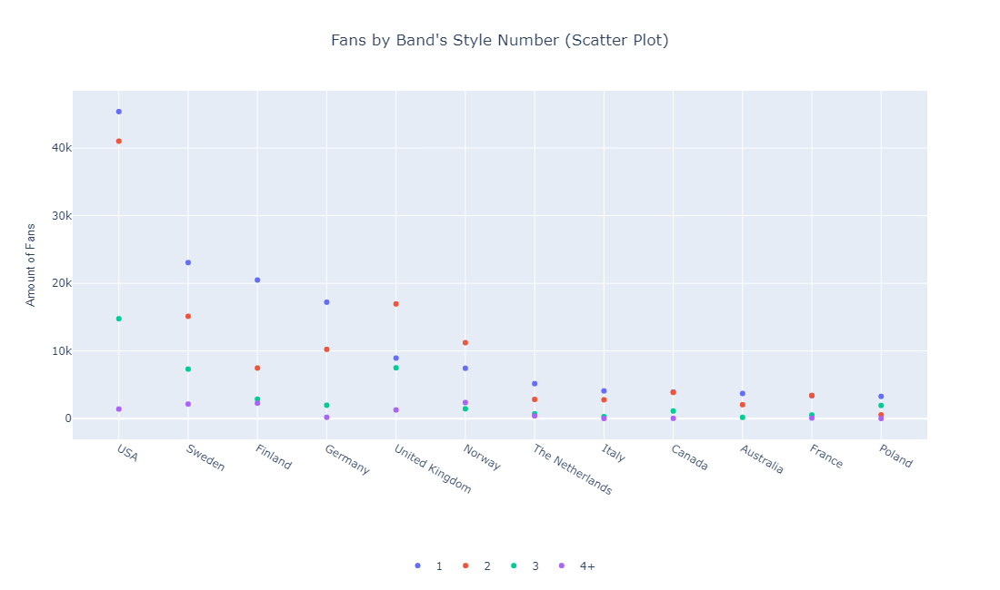
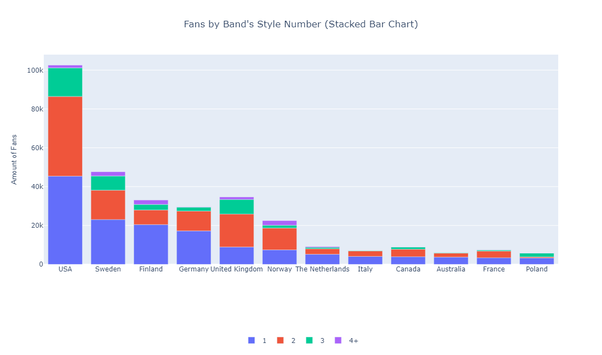
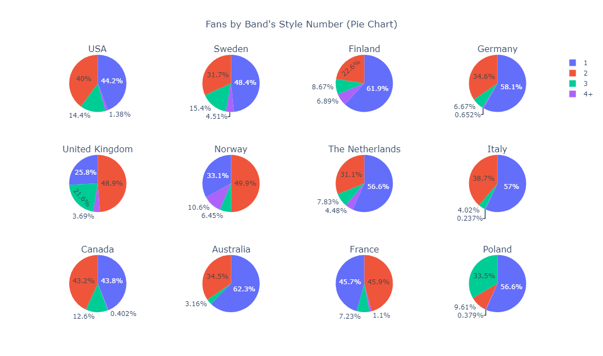
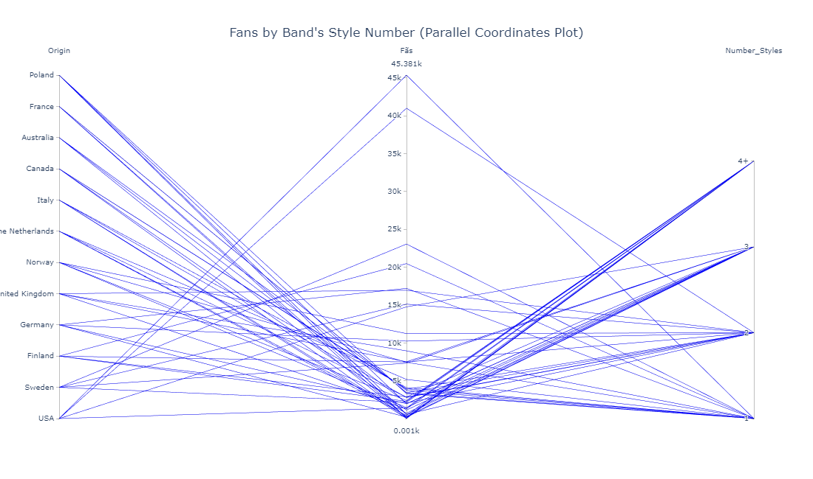
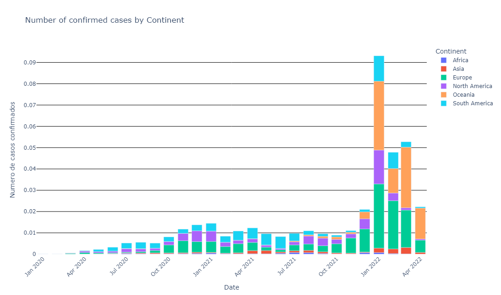
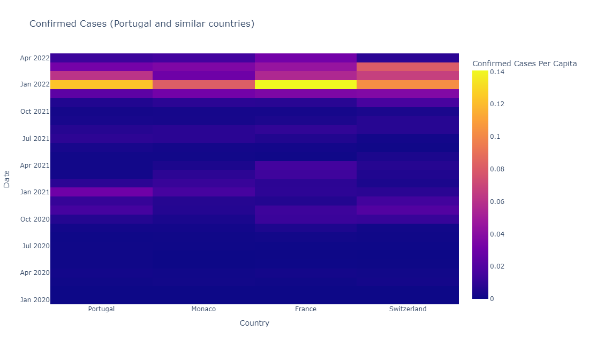
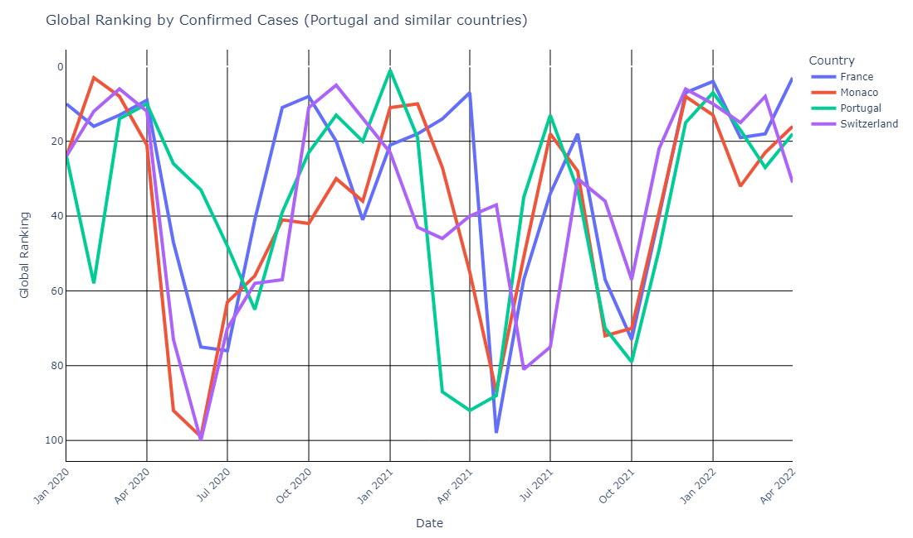
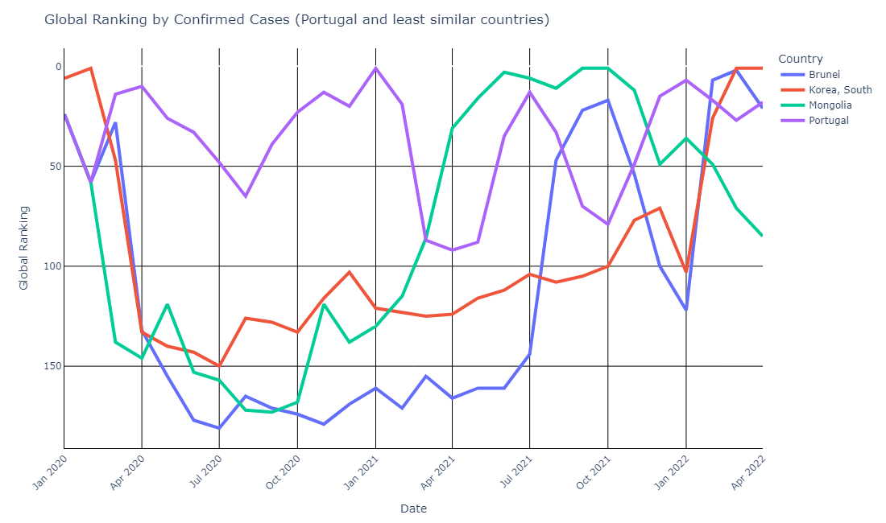

# Data Visualization Projects

Two projects from the Data Visualization course (University of Coimbra, 2023/24), both built with Plotly. GitHub does not render interactive Plotly charts, so static exports are shown below. The notebooks' code and charts were not changed (see *Changes from the submitted version*).

## 1. Metal bands by country

*Individual project.* The same question — how the fans of metal bands are spread across countries and across the number of styles a band plays — shown with four visualization models, followed by a critical comparison of which one communicates it best (the stacked bar chart).

| Scatter plot | Stacked bar chart |
|---|---|
|  |  |
| **Pie charts** | **Parallel coordinates** |
|  |  |

Notebook: [metal_bands.ipynb](metal-bands-by-country/metal_bands.ipynb). It needs `metal_bands_2017_v2.csv` from the Kaggle dataset [Metal bands by nation](https://www.kaggle.com/datasets/mrpantherson/metal-by-nation) (not included) in the same folder.

## 2. COVID-19 dashboard

*Developed with Afonso Cordeiro.* An interactive Dash dashboard on the COVID-19 pandemic from January 2020 to April 2022. It answers three questions:

- How did confirmed cases evolve per continent?
- Which countries behaved most and least like Portugal?
- How did cases in Portugal evolve month by month?

| Confirmed cases by continent | Portugal vs. the most similar countries (cases per capita) |
|---|---|
|  |  |
| **Global ranking: most similar countries** | **Global ranking: least similar countries** |
|  |  |

The dashboard also includes an animated gauge of monthly cases in Portugal. Notebook: [covid19_dashboard.ipynb](covid19-dashboard/covid19_dashboard.ipynb); progress report: [progress-report-pt.pdf](covid19-dashboard/progress-report-pt.pdf) (Portuguese).

The data is included:
- `countries-aggregated.csv` and `reference.csv` come from the [datasets/covid-19](https://github.com/datasets/covid-19) repository (ODC Public Domain).
- `country-by-continent.json` comes from [samayo/country-json](https://github.com/samayo/country-json).

## How to run

```bash
pip install pandas numpy "plotly<6" dash
```

Then open a notebook and run all cells. Both notebooks were re-run for this repository with Plotly 5. The COVID-19 notebook starts the dashboard with `app.run_server()`.

## Changes from the submitted version

- `metal_bands.ipynb` saved a full copy of the Plotly.js library (3.6 MB) in the output of its first cell. It was replaced by a link to the same version (2.12.1) on Plotly's CDN, which is what Plotly itself writes in connected mode. The code and all other outputs are unchanged.
