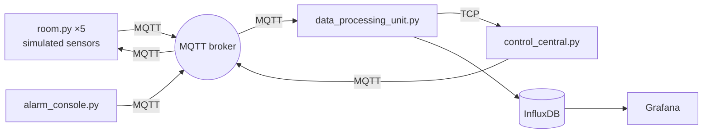

# Museum IoT Monitoring

A simulated monitoring and control system for 5 rooms of a museum. Each room has temperature, humidity and motion sensors. The system keeps temperature and humidity close to their ideal values by switching air conditioning and humidity regulators on and off, raises an alarm on intrusion, and stores everything in a time-series database for a Grafana dashboard.

*Developed with Gonçalo Cartaxana. Course: Sensing and Actuation Systems and Networks, University of Coimbra, 2023/24. Report: [report-pt.pdf](report-pt.pdf) (Portuguese).*

## Architecture



| Component | Role |
|---|---|
| `room.py` | Simulates one room: publishes temperature, humidity and motion readings as JSON. When the devices are on, temperature and humidity move towards their ideal values |
| `data_processing_unit.py` | Checks readings against the limits in `intervals.cfg`, converts Fahrenheit to Celsius, discards invalid sensor types, detects rooms that stop sending data (15 s), tracks device run time and energy cost, and writes everything to InfluxDB |
| `control_central.py` | Receives commands from the processing unit over TCP and switches the devices in each room |
| `alarm_console.py` | Turns the intrusion alarm on and off |
| `mqtt_debugger.py` | Prints the MQTT traffic |
| `part1-raspberry-pi/` | First part of the project, run on a Raspberry Pi: an alarm node that drives LEDs through GPIO |

## How to run

```bash
pip install paho-mqtt influxdb3-python certifi config
python part2-simulation/room.py <group_id> <temp_interval_s> <motion_interval_s>
```

The broker address (`10.6.1.9`) is the one from the university lab, and the processing unit writes to an InfluxDB Cloud instance. Both need to be replaced to run the system elsewhere. It was not re-tested for this repository.

## Changes from the submitted version

- The InfluxDB token in `data_processing_unit.py` was replaced by the placeholder `{token}`.
